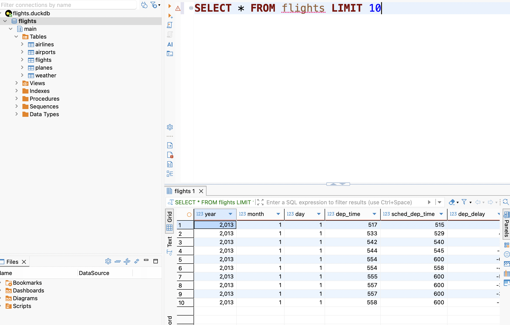

Load packages, download the `flights.duckdb` file, and create the connection to the database with `duckdb`.

```{r}
#| label: setup
#| message: false
library(tidyverse)
library(DBI)
library(duckdb)

# Download the DuckDB file from the provided URL
url <- "https://data-science-master.github.io/lectures/data/flights.duckdb"

download.file(url, destfile = "flights.duckdb", mode = "wb")

#create the connection and help translate between R and the database
conn <- dbConnect(duckdb(), "flights.duckdb", read_only = TRUE)

dbIsValid(conn) #check the connection
```

*Note: I completed all section of Part 1 in an R file, first, before creating this qmd file. Thus, my first five git commits will reflect changes in the .R file for each section. Then, between completing parts 1 and 2, I created the qmd file, added the commentary and code chunks for part 1, and inserted the screen shots for Part 2.*

## Part 1a  - List the first 10 rows of the flights table. 

I was uncertain if I was supposed to use R commands and have them translated into SQL, but since the directions said to run SQL using RStudio, I used the following code structure for all of my solutions. It uses the `DBI` command `dbGetQuery()` to run the SQL code through the `duckdb` connection defined above (`conn`).

```{r}
#Part 1a - List the first 10 rows of the flights table
dbGetQuery(conn, 
           "SELECT * --get all columns
           FROM flights --from the flights table
           LIMIT 10 --first 10 rows"
)
```

And here's the DBeaver screenshot:



## Part 1b - Find the number of flights in the `flights` table, then by each carrier

I wasn't sure if I was supposed to combine these into one SQL command, or have them be separate (i.e., find total number of flights with one command, then group them by `carrier` with another). I chose to do them separately with the following code chunks:

First, find the total number of flights using the `COUNT` command.

```{r}
#Part 1b - first, find the number of flights in the dataset

count_flights <- "SELECT COUNT(*) --counts the number of rows
                  FROM flights --in the flights table" 

dbGetQuery(conn, count_flights) #returns the result
```

Second, select the `carrier` column in the `flights` table, count the number of flights and store in a new column `n_flights` and group by carrier.

```{r}
#Part 1b - second find the number of flights by carrier

carrier_flights <- "SELECT carrier, --select the carrier column
                    COUNT(*) AS n_flights --count the number of rows
                    FROM flights --in the flights table
                    GROUP BY carrier --grouped by carrier"

dbGetQuery(conn, carrier_flights) #returns the result
```

For this and the following problems, I chose to write the SQL code first and store it as a variable, then run the query with the variable as an argument. This helped me organize my thoughts better.

## Part 1c - Find the average departure delay

Calculate the mean `dep_delay` from the `flights` table and then display the results:

```{r}
#Part 1c - Find the average departure delay

dep_delay <- "SELECT AVG(dep_delay) AS dep_delay  --find the mean dep_delay
              FROM flights -- from the flights table"

dbGetQuery(conn, dep_delay) #returns the result 
```

## Part 1d - Find the top 5 destinations with the most fights

Using SQL, I selected the `dest` column in the `flights` table, stored the number of flights in a new column `n_flights` and then grouped by destination, ordered them from most –\> least and returned the top 5 destinations.

```{r}
#Part 1d - Find the top 5 destinations with the most flights

top_five <- "SELECT dest, --select the destination column
             COUNT(*) AS n_flights --counts flights and stores in a new column
             FROM flights --in the flights table
             GROUP BY dest --grouped by destination
             ORDER BY n_flights DESC --order from high to low
             LIMIT 5 --return only the top 5"

dbGetQuery(conn, top_five) #return result
```

## 1e - Create a table showing the carrier, average `arr_delay` and sort from largest to smallest

This wording of this problem confused me. I'm not sure if I'm supposed to create a different type of `tbl()` object. I couldn't find any clarification in the notes, so I used the same type of code structure as before.

I selected the `carrier` column and created a new column `avg_arr_delay` by calculating the mean of the `arr_delay` column in the `flights` table, then grouped by `carrier` and sorted the `avg_arr_delay` in descending order.

```{r}
#Part 1e - create a table with carrier and average arrival delay, sorted from largest to smallest

carrier_delays <- "SELECT carrier, 
                   AVG(arr_delay) AS avg_arr_delay  --select & find avg
                   FROM flights --in the flights table
                   GROUP BY carrier --grouped by the carrier
                   ORDER BY avg_arr_delay DESC --order from high to low"

dbGetQuery(conn, carrier_delays) #return results   
```

Finally close the connection:

```{r}
dbDisconnect(conn) #close the connection
dbIsValid(conn) #confirm connection is closed
```

## 
